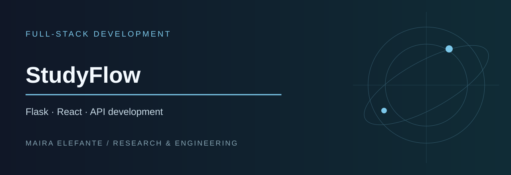

# StudyFlow: Flask + React Task Manager

**Python · Flask · REST API · React · Vite**

StudyFlow is a personal full-stack project for organizing study tasks and technical practice. It provides a small Flask API and a React interface for creating, viewing, completing, and deleting tasks. It is currently a local development prototype, designed for learning and iterative improvements rather than production deployment.

## What works in the existing code

- View an initial set of study tasks from the Flask API.
- Add tasks with non-empty titles through the React interface.
- Toggle completion and delete tasks.
- Run a Flask backend and a React/Vite frontend locally.
- Access the REST endpoints directly.

**Current limitations:** task data is held in Python process memory and is reset when the backend restarts. The frontend uses a hard-coded localhost API URL. There are currently no automated tests, authentication, hosted deployment, or database migrations.

## Project layout

```text
studyflow-flask-react-api/
├── README.md                 # This document
├── LICENSE                   # MIT license
├── REPORT.md                 # Technical review and future roadmap
├── cover.svg
└── studyflow-flask-react-api/
    ├── backend/
    │   ├── app.py
    │   └── requirements.txt
    ├── frontend/
    │   ├── index.html
    │   ├── package.json
    │   └── src/
    │       ├── App.jsx
    │       ├── main.jsx
    │       └── styles.css
    └── README.md
```

## Getting started

**Prerequisites:** Python 3, pip, Node.js, and npm. Run backend and frontend in separate terminals.

### Backend

```bash
cd studyflow-flask-react-api/backend
python3 -m venv .venv
source .venv/bin/activate
pip install -r requirements.txt
python app.py
```

On Windows, activate the virtual environment using `.venv\Scripts\activate`. The Flask development server is configured to start locally on port 5000.

### Frontend

From the repository root, in a second terminal:

```bash
cd studyflow-flask-react-api/frontend
npm install
npm run dev
```

Open the local URL printed by Vite (typically `http://localhost:5173`). The frontend expects the backend at `http://localhost:5000/api/tasks`.

These commands follow the current source structure; they have not been independently executed as part of this documentation update.

## API

| Method | Route | Behavior |
| --- | --- | --- |
| GET | `/api/tasks` | List tasks |
| POST | `/api/tasks` | Create task from `{"title": "Read chapter 2"}` |
| PATCH | `/api/tasks/<id>` | Update `title` and/or `completed` |
| DELETE | `/api/tasks/<id>` | Remove task |

Example:

```bash
curl http://localhost:5000/api/tasks
curl -X POST http://localhost:5000/api/tasks -H "Content-Type: application/json" -d '{"title":"Study numerical methods"}'
```

## Future development

There is meaningful work ahead: persistent SQLite storage and migration support, input validation and reliable error handling, priorities and deadlines, sorting and filtering, progress summaries, automated tests, accessibility improvements, and more robust configuration. See [REPORT.md](REPORT.md) for a proposed **27-hour** development plan and its verification criteria. Planned features are **not yet implemented**.

## Safety and licensing

Use dummy study tasks in examples; do not commit real personal records or credentials. This repository is licensed under the [MIT License](LICENSE).

## Author

Maira Elefante
